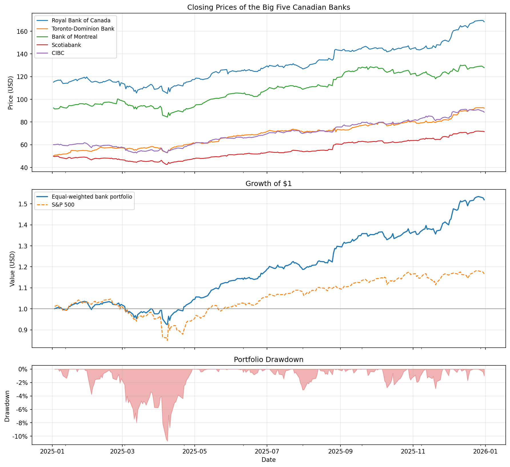
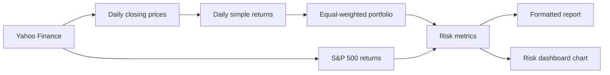

# Big Five Canadian Banks: Risk Metrics Analysis

**Risk and performance analytics for an equal-weighted portfolio of Canada's largest banks 2025 - 2026.**

[](https://www.python.org/)
[](https://pypi.org/project/yfinance/)
[](LICENSE)



This project builds an equal-weighted portfolio of the Big Five Canadian banks using their NYSE
listings, then measures its return, volatility, market sensitivity, risk-adjusted performance and
tail risk against the S&P 500. Everything runs from a single script: it downloads daily prices,
computes fourteen metrics, prints a formatted report and saves a three-panel chart.

> This is an educational analysis of historical data. It is not investment advice, and past
> performance over a single year does not predict future returns.

## Pipeline



## Portfolio

| Ticker | Bank | Weight |
|--------|------|--------|
| RY  | Royal Bank of Canada | 20% |
| TD  | Toronto-Dominion Bank | 20% |
| BMO | Bank of Montreal | 20% |
| BNS | Scotiabank | 20% |
| CM  | CIBC | 20% |

The NYSE listings are used so that prices are in USD and trade on the same calendar as the
S&P 500 benchmark.

## Metrics

**Return and risk**
- Annualized return: $(1 + \bar{R})^{252} - 1$
- Annualized volatility: $\sigma_{daily}\sqrt{252}$
- Downside deviation: root mean square of daily shortfalls below the target return, annualized
- Maximum drawdown: largest peak-to-trough decline of the wealth index $W_t = \prod (1 + R_t)$

**Market sensitivity**
- Beta: $\beta = \dfrac{\text{Cov}(R_p, R_m)}{\text{Var}(R_m)}$
- Jensen's alpha (CAPM): $\alpha = (\bar{R}_p - R_f) - \beta(\bar{R}_m - R_f)$, annualized

**Risk-adjusted performance**
- Sharpe ratio: $(R_p - R_f) / \sigma_p$
- Sortino ratio: $(R_p - R_f) / \sigma_d$
- Treynor ratio: $(R_p - R_f) / \beta$
- Calmar ratio: $R_p / \text{MDD}$

**Tail risk** (one-day horizon, historical simulation on a $1,000,000 portfolio)
- Value at Risk at 90%, 95% and 99% confidence
- Expected Shortfall (CVaR) at 95% confidence

## Results

Period: 1 January 2025 to 31 December 2025

| Metric | Value |
|--------|-------|
| Annual return | 54.17% |
| Annual volatility | 14.14% |
| Beta | 0.510 |
| Alpha (CAPM) | 31.05% |
| Sharpe ratio | 3.335 |
| Sortino ratio | 5.073 |
| Calmar ratio | 5.049 |
| Treynor Ratio | 0.924 |
| Max drawdown | 10.73%|
| VaR 95% (1-day) | $12,559 |
| CVaR 95% (1-day) | $19,680|

## Quick start

```bash
git clone https://github.com/ANAMO-STAR/Major-Canadian-Banks-Risk-Metrics-Analysis.git
cd Major-Canadian-Banks-Risk-Metrics-Analysis
python3 -m venv .venv
source .venv/bin/activate
pip install -r requirements.txt
python risk_metrics.py
```

On Windows, activate the environment with `.venv\Scripts\activate` instead.

Tickers, dates, weights, portfolio value and the risk-free rate are set in the configuration
block at the top of `risk_metrics.py`.

## Repository structure

```text
risk_metrics.py     data download, metric calculations, report and chart
images/             generated risk dashboard
requirements.txt    Python dependencies
LICENSE             MIT license
```

## Limitations and roadmap

- One year of daily data is a short window; beta and the ratios can shift considerably with a
  longer period or a different return frequency.
- Weights are fixed and equal, with no rebalancing or transaction costs.
- Historical VaR assumes the past year's return distribution represents the next day.
- The risk-free rate is a single constant rather than a daily Treasury bill series.
- Possible extensions: rolling beta and volatility, parametric and Monte Carlo VaR, mean-variance
  optimized weights, and a comparison against the TSX using the Toronto listings.

Released under the [MIT License](LICENSE).
